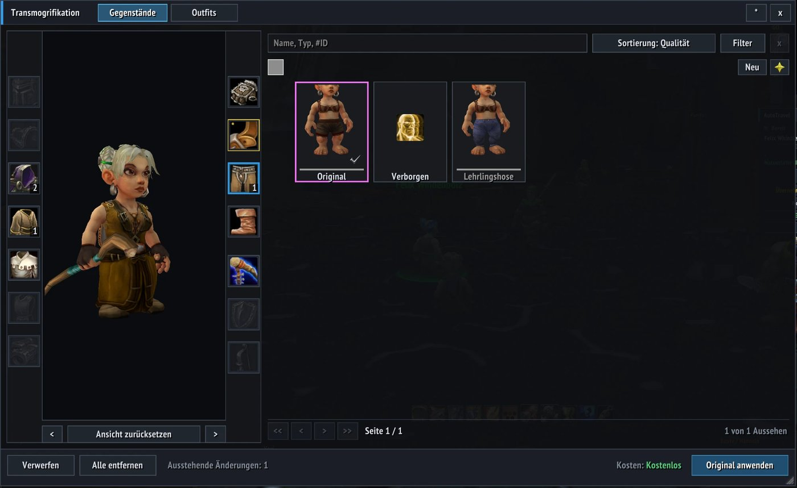

# Transmog

A modern **wardrobe window** for **World of Warcraft 3.3.5a** on an **AzerothCore** server that runs the module
[mod-transmog-plus](https://github.com/Stefan2102/mod-transmog-plus): a large 3D preview of your character, a grid of the
appearances you have collected with search and filters, outfits and a cost display. Version 2.1.



## Features

* All 14 transmog slots around a 3D preview that follows every selection (rotate, move, zoom).
* Appearance grid with search, sorting, quality and type filters, favourites, "new" marks, paging.
* Outfits: save, load (nothing is applied until you press Apply), overwrite, rename, delete.
* Cost display, pending changes per slot, apply / discard / remove all; the server checks collection, rules and money.
* **Transmog anywhere:** `/transmog` is enough, no transmogrifier NPC needed (the server does not check the distance).
  Talking to the NPC still opens the window.
* Tooltip lines ("appearance not collected", "transmogrified to"), notification cards for new appearances.
* Resizable window with scaling; 8 interface languages: English, German, French, Spanish, Russian, Korean, Chinese
  (simplified and traditional).

## Requirements

* WoW client 3.3.5a (Interface 30300).
* An AzerothCore server with the **mod-transmog-plus** module enabled. Without it nothing answers; the addon says so.
* This addon replaces the older addon bundled in the module's `addon/Transmog` folder. Do not install both.

## Installation

1. Copy this folder to `World of Warcraft/Interface/AddOns/` so that it is named exactly **`Transmog`** (when you
   download the ZIP from GitHub, rename `Transmog-main` accordingly; `tests/` and `docs/` are not needed to play).
2. Restart the game completely (a `/reload` does not pick up newly copied files). On login a chat line
   "Transmog 2.1 ... /transmog" appears.

## Usage

`/transmog` (or `/xmog`) toggles the window; you can also bind a key under Esc > Key Bindings > Transmog.
Pick a slot, pick a tile, press **Apply**. Right click on a slot discards a pending change or marks the applied
appearance for removal; right click on a tile toggles the favourite.

```
/transmog options                 options window (also the * button in the title bar)
/transmog reset                   reset window position and size
/transmog toast                   move the notification anchor
/transmog lang auto|en|de|fr|es|ru|ko|zhCN|zhTW   interface language
/transmog debug | help            diagnostics, command list
```

Full description: [docs/MANUAL.en.md](docs/MANUAL.en.md) (English), [docs/MANUAL.de.md](docs/MANUAL.de.md) (German,
including protocol and code layout), in-game test list [docs/CHECKLIST.de.md](docs/CHECKLIST.de.md).

## Status

Written for a private AzerothCore server and used by the author on a German 3.3.5a client. Confirmed in the real game:
**applying without the transmogrifier NPC (version 2.1) works with the live server.** The rest of the in-game check
list was only partly checked, there was no systematic in-game testing; for example the sound after applying (now a stock
client sound), model camera framing and the Cyrillic/Korean/Chinese fonts on a Western client are not verified in game.
The automated tests (over 1,300) run against a strict mock of the 3.3.5a client API, not against a real client.
Written with the help of Claude (Anthropic's AI assistant).

## Tests

Needs [LuaJIT](https://luajit.org/) (a stand-in for the game's Lua 5.1), e.g. `brew install luajit`, plus `xmllint` or
`python3` for the XML check:

```
bash tests/check.sh --strict --smoke    # syntax, globals, locale, style, API checks, the test suite, smoke tests
luajit tests/render_ui.lua --list       # window layouts as SVG without a game client (written to tests/out/)
```

## Deutsch (Kurzfassung)

Ein modernes **Garderoben-Fenster** für WoW **3.3.5a** auf einem AzerothCore-Server mit dem Modul mod-transmog-plus:
3D-Vorschau, Raster der gesammelten Aussehen mit Suche und Filtern, Outfits, Kostenanzeige, 14 Slots, 8 Sprachen.
Installation: Ordner nach `Interface/AddOns/Transmog` kopieren (Ordnername genau `Transmog`), Spiel neu starten.
Befehl: `/transmog` (oder `/xmog`); Transmogrifizieren geht überall, ohne den NPC (seit Version 2.1, im echten Spiel mit dem
laufenden Server bestätigt). Der übrige Spieltest ist nur teilweise erfolgt. Ausführliche Beschreibung (Deutsch):
[docs/MANUAL.de.md](docs/MANUAL.de.md).

## License

[GNU AGPL v3](LICENSE), Copyright (C) 2026 nexartgroup - see [NOTICE](NOTICE) for the origin of the camera calibration
values and item-class names taken from the older addon bundled with mod-transmog-plus (which is why this is AGPL and
not MIT).
